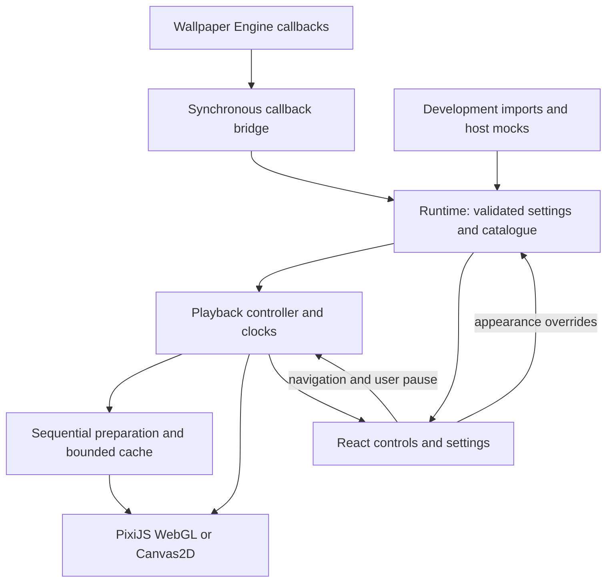

# Architecture and behavioral contracts

The wallpaper is an offline browser application. Retain Vite, React, TypeScript, React Compiler, and Oxlint; Node is development/build/test tooling only. The [product direction](product-direction.md) defines priorities. This document owns technical contracts; source and CodeGraph supply implementation details.

## Responsibilities and data flow

| Boundary | Owner and contract |
| --- | --- |
| Host adapter | Bridge buffers early user/general properties, pause, and directory events in arrival order. |
| Settings | Shared definitions generate host properties and validate runtime values; preferences retain host values separately from local overrides. |
| Catalogue | Owns IDs, names, URLs, revisions, and browser object URLs; never decodes images. |
| Playback | Selects entries, owns clocks/history and the single preparation worker; coordinates readiness and rendering. |
| Resource cache | Reserves a bounded set of prepared slides and releases evicted resources. |
| Renderer | Composes images/backgrounds and draws transitions; owns GPU/fallback resources. |
| React | Subscribes to immutable cached snapshots via `useSyncExternalStore`; owns controls and accessible settings, not decoding or frame work. |

## Packaging and initialization

Production uses a classic IIFE JavaScript bundle and relative local assets, with no runtime module/Node imports, CDN, external fonts, or required server/network. A build plugin generates production HTML after CSS emission, host properties from settings definitions, version metadata, and license notices. Ship the complete `dist/` folder. The wallpaper fills its viewport without scrollbars or the Fullscreen API.

`public/wallpaper-bridge.js` installs `window.wallpaperPropertyListener` in the document head before application initialization. Its typed contract is `src/wallpaper/bridge.d.ts`. One consumer connects through `wallpaperBridge.connect`; queued events drain synchronously and reentrant arrivals remain ordered. Repeated bridge bootstrap is harmless; a second simultaneous consumer is rejected. Disconnect removes the consumer.

The runtime connects before asynchronous renderer initialization and React mounting. Host events are partial patches: missing/invalid values preserve prior valid state. General FPS starts at 30, accepts finite nonnegative numbers, and uses zero for uncapped playback. Development preview uses the same callback bridge for host mocks; overlay edits are actual local overrides, not simulated host changes.

## Settings and persistence

Settings definitions are the source for property keys, types, bounds, defaults, and display conditions. Validation accepts known own properties, rejects malformed types/options, clamps sliders, and converts host color channels to hex.

| Setting | Default |
| --- | --- |
| Source | Bundled samples |
| Hold / transition | 30 seconds / fade, 1 second |
| Shuffle / sizing | Off / Fill |
| Fit background | Blurred image; black solid alternative |
| Blur | 24 screen pixels |
| Navigation/settings overlay | Enabled |

Startup precedence is **defaults → initial host settings → saved overlay overrides**. Every event drained during bridge connection preserves overrides. If none supplied valid settings, the first valid later host event also preserves them. After initialization, a value differing from the last host value clears its matching override; repeated or unrelated host values preserve overrides. Reset clears overrides and restores the latest host values.

Only hold, transition/duration, shuffle, sizing, background/color, and blur persist under `slideshow-studio.preferences.v1` in a versioned JSON envelope with shared validation. Source paths, master controls switch, and pause state never persist through the overlay. Storage getter/write/removal failures, corrupt data, and unknown schemas leave session controls usable. Storage scope follows browser origin/profile; package moves or host changes can expose different records. Application version and storage schema version are independent; see [release guidance](releases.md).

## Sources and resource lifecycle

Sources are bundled samples, one image, or a directory. Native `fetchall` callbacks collect paths and apply additions/modifications/removals; modified entries receive new revisions. Directory metadata remains available when another source is active. Where a directory root is supplied, replacement keeps entries already received for the new root and excludes old-root entries; callbacks also work without a location value.

Windows drive/UNC identities are case-insensitive; POSIX identities retain case. Raw paths encode reserved URL characters; encoded `file://` URLs retain escaping. Relative paths and non-file schemes are rejected. Browser imports release session object URLs on replacement, clearing, disposal, and failed partial import.

One worker prepares candidates sequentially. Abort signals and generation checks discard stale work; replacement waits for the previous preparation promise to settle even if a custom loader ignores cancellation. Preparation loads/decodes, downsamples to a retained canvas, and releases the source image reference. A 30-second timeout clears the source; native revision query tokens prevent stale browser-cached pixels after modifications.

| Resource contract | Limit or behavior |
| --- | --- |
| Prepared slides | At most three, reserving the in-flight slot before preparation. Priority: current, incoming/requested, next, previous. |
| Estimated owned resources | 256 MiB total: 112 MiB rendering reserve plus eight bytes per prepared pixel (canvas and GPU source texture). Each slide fits one third of the remainder. |
| Resolution | Useful viewport resolution, at most 8192 pixels per texture side; display at most 8,388,608 pixels. |
| Eviction | Release GPU resources before zeroing prepared canvas dimensions; older history loses priority first. |
| Failure | Skip a failed revision without endless retries; source reselection or modification permits another attempt. Empty/all-failed sources show status; one image stays static. |
| Resize/disposal | Retain the current image until replacement is ready; clear old backing stores before resizing. Dispose listeners, clocks, loads, resources, and late results. |

The resource estimate excludes native decoding, browser caches, temporary source allocations, and process overhead. It is not a process-memory cap. Hardware-specific measurements and limitations belong in [verification](verification.md).

## Playback and rendering

Natural filename order is the default. Shuffle visits available images once per cycle without an immediate cycle-boundary repeat; previous/next follows actual visits, retaining up to 512 history entries. Catalogue/shuffle changes start a new cycle while retaining valid current/history entries. Navigation requests coalesce while preparation is pending; the old slide stays visible until readiness.

Hold time starts after transition completion; manual navigation restarts it. Host, user, and hidden-document pauses overlap: all must clear before playback resumes. Hold and transition clocks preserve remaining time and never catch up missed slides. Manual navigation while paused swaps instantly and remains paused. Transition setup completes before its clock starts. Source/order changes cancel an active transition while retaining a valid outgoing slide; resize completes a ready incoming slide before re-preparing.

Fill covers/crops. Fit contains a sharp foreground over a solid color or covered, blurred duplicate. PixiJS shares the prepared source texture, warms it during prefetch, and caches at most two opaque slide compositions. Blur uses targets capped to a 512-pixel longest dimension. Fade blends compositions; slide moves them in navigation direction. An active transition captures effect/duration; appearance changes invalidate compositions immediately. Instant ignores duration.

The controller schedules frames only for transitions or invalidation, paced by host FPS with fractional intervals preserved. Static slides schedule no animation frames; PixiJS tickers are disabled. Canvas2D caches equivalent compositions with reduced-resolution blur. Unsupported WebGL/render failures select fallback; context loss temporarily selects Canvas2D and restoration rebuilds GPU compositions. Disposal releases textures, compositions, blur pools, and canvases.

## Interaction boundary

Native properties own image/folder selection and the master overlay switch. Disabling it unmounts controls and removes shortcuts/listeners/timers. Navigation is disabled when unavailable or pending; empty sources also disable pause. Hidden toolbar controls remain keyboard-reachable. Radix Dialog owns modal focus trapping, dismissal, and focus return; Lucide supplies local bundled SVG icons. Fields/buttons retain native key behavior; playback shortcuts ignore editing fields.

See the [operating guide](operating-guide.md) for controls and preview URLs, [desktop lessons](desktop-lessons.md) before layout/host work, and [verification](verification.md) before making compatibility claims. Video, animated playback, and audio visualization remain deferred.
